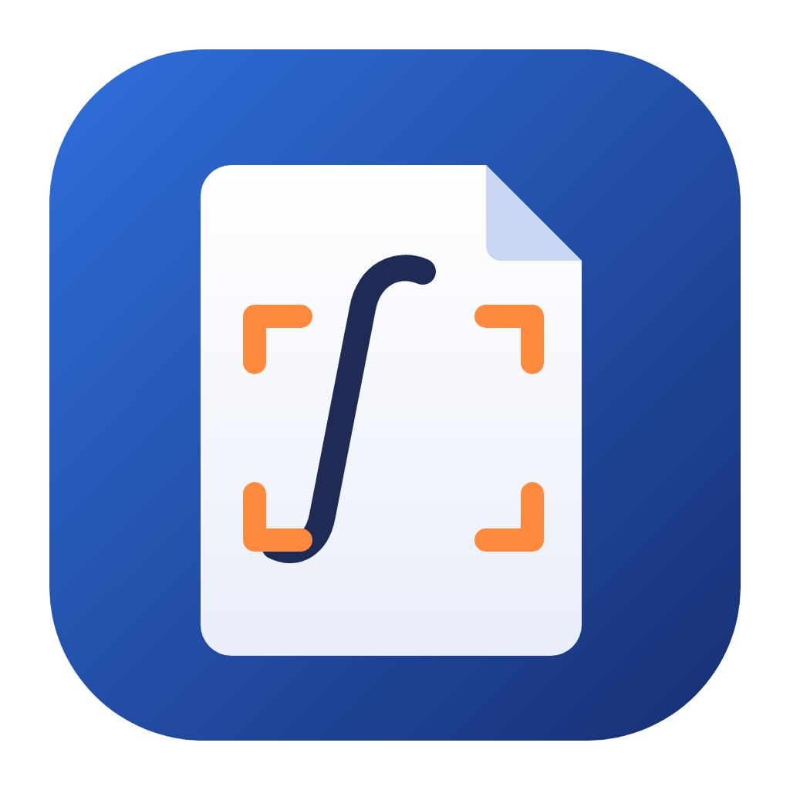

<p align="center"></p>

# Alice STEM Reader

**資料を見ながら、数式と文章を「その部分だけ」LaTeX・Markdown にする、手元で動く STEM リーダー。**

PDF ビューアで教科書・論文・講義資料を読みながら、**フラッシュカードを作ったり、レポートや論文を書いたりするのに最適**です。
気になる式を囲む（Snip する）だけで、編集できる LaTeX がクリップボードに入ります。画面に映っているもの、手書きのノートの写真、
EPUB・DjVu・Markdown・LaTeX の原稿も、同じ操作で読めます。

- **すべて手元の PC で動く。** 資料も画像も、外部に送りません（外部の認識サービスは、明示的に選んで同意したときだけ）。
- **原本は変えない。** 認識の結果・メモ・変換した PDF は、別の場所（ライブラリ）に保存します。
- **どこから来たかが残る。** Snip ごとに、資料名・ページ・範囲・資料のハッシュ・認識エンジンと版・日時を記録します。

[English summary](#english)

---

## できること

| | |
| --- | --- |
| **Snip（範囲を読む）** | 画面の任意の範囲（macOS）・資料のページの範囲・画像（ファイル・貼り付け・ドロップ）を読み、**数式は LaTeX、文章＋数式は「文章 `\( … \)`」** にする。結果は履歴に残り、修正・コピー・書き出しができる |
| **数式をクリックでコピー** | ページ全体の数式を検出・認識しておけば、式の枠をクリックするだけで LaTeX をコピー。見落とした式はドラッグで追加 |
| **多くの形式** | PDF（スキャン可）・EPUB・MOBI・FB2・XPS・CBZ・DjVu・画像（PNG・JPEG・TIFF・HEIC・WebP など）・Markdown・LaTeX・テキスト |
| **手書き** | 手書きの式やノートの写真も読める（スマートフォンの写真の向きは自動で補正） |
| **書き出し** | Snip の履歴を **Markdown・LaTeX・TSV（フラッシュカードのアプリに読み込める）・JSON（出所の記録つき）** に。資料ごとに、認識した文章と数式を読む順に並べた **Markdown / LaTeX の原稿** も作れる |
| **数式をコピーできる PDF** | 見た目は原本と同じまま、数式を選ぶと LaTeX が取れる派生 PDF を作る（macOS のプレビューなど、普通のビューアで使える）。外観・構造・コピーを検証してから保存 |
| **確認を助ける** | 2 つのモデルの読みが食い違った式に「要確認」の印を付ける（任意） |
| **資料の整理** | フォルダの階層をそのまま並べる（Obsidian 風）。名前の変更・移動・ゴミ箱、ビューア専用のフォルダ、まとめて OCR（中断・再開可） |
| **使いやすさ** | 日本語・English・中文・Español・Русский、ライト / ダーク、キーボード操作、資料ごと・ページごとのメモ |

## はじめかた（macOS）

アプリとして Launchpad・Spotlight・Raycast などのランチャーから開き、画面はいつものブラウザで表示します。

```bash
git clone https://github.com/lua720s/Alice-STEM-Reader.git && cd Alice-STEM-Reader
python3.12 -m venv .venv && .venv/bin/pip install -e .
scripts/setup_models.sh                                   # 認識モデルの導入（約 6GB、SHA-256 を照合）
.venv/bin/python -m pdf_latex_overlay build-app            # ~/Applications にアプリを 2 つ作る
```

- **Alice STEM Reader** — ビューアを開きます。左上の「＋」で資料やフォルダを追加。Finder で資料を右クリック →「このアプリケーションで開く」、アイコンへのドロップでも開けます（既定で開くアプリは変えません）。
- **Alice STEM Snip** — 起動すると、すぐ画面の範囲選択になります。選んだ部分を読んで、**結果をクリップボードに入れ、通知でお知らせ**します。
  キーボードショートカットに割り当てると、Mathpix Snip と同じ感覚で使えます（Raycast・Alfred のホットキー、または「ショートカット」アプリ）。

初回だけ、macOS の許可が必要です。

- **画面収録**: 「画面を Snip」を初めて使うとき（システム設定 → プライバシーとセキュリティ → 画面収録）。
- **フォルダへのアクセス**: 書類などのフォルダを初めて開くとき。

ビューアは 1 つだけ常駐し、画面からの操作が 120 分なければ自動で終了します。

## 使いかた

### Snip

| 操作 | 内容 |
| --- | --- |
| 右のパネルの **「画面を Snip」**（または `S`、上のバーの Snip） | 画面の範囲をドラッグで選ぶ。結果はクリップボードへ（Esc で取り消し） |
| **「ページの範囲」**（`R` で切り替え）＋ページ上をドラッグ | 開いている資料の範囲を読む（枠は残さない）。文字層がある資料では「文字層を使う」も選べる |
| 画像を **⌘V / Ctrl+V** で貼り付け、パネルへ **ドロップ**、**「画像…」** で選ぶ | スクリーンショット・手書きのノートの写真などを読む（複数可） |
| **読み方** | 自動（文章と数式を見分ける）／数式（LaTeX）／文章 |
| **書き出す…** | Markdown（`$…$`）・LaTeX・TSV・JSON |

**Markdown・テキスト・（コンパイルできなかった）LaTeX の原稿** をページの範囲で Snip すると、OCR を使わずに **原文そのもの** を取り出します（`$…$` の中身も崩れません）。

### 数式の検出と認識、派生 PDF

- 上のバーの **「このページを認識」** で、表示中のページの数式を検出・認識。資料全体は ⋯ メニューの「OCRを行う」（フォルダや複数選択でも可。進み具合の表示・キャンセル・再開あり）。
- 式の枠を **クリックでコピー**、右のパネルで修正・確定・除外・再認識。
- **「このページの文章を認識」** で日本語などの文章も読む（緑の枠）。
- **「PDFを保存」** で、数式（と文章）を不可視テキストとして埋め込んだ派生 PDF を作る。見た目が 1 画素でも変わる、構造が保てない、などの検証に通らなければ保存しません。
- ⋯ メニューの **「認識した内容を Markdown / LaTeX に書き出す」** で、ページの上から下・左から右の順に並べた原稿（メモも含む）を作る。

### キーボード

| キー | 動作 | キー | 動作 |
| --- | --- | --- | --- |
| `S` | 画面を Snip | `R` | ページ上のドラッグ: Snip ⇄ 枠を追加 |
| `←` `→` `Space` | ページ送り | `F` | ページ全体 ⇄ 幅に合わせる |
| `+` `-` `0` | 拡大・縮小・元に戻す | `B` | コレクションの開閉 |
| `C` | 選んだ式をコピー | `Delete` | 選んだ枠を削除（元に戻せる） |
| `N` / `Shift+N` | 次 / 前の「要確認」 | `/` | 資料を検索 |

### コマンド

```bash
alice-stem-reader viewer 資料フォルダ/ --backend unimernet     # ビューア（127.0.0.1 のみ）
alice-stem-reader snip 写真.jpg --mode auto --copy            # 画像 1 枚を読む（--screen で画面の範囲）
alice-stem-reader prepare 資料フォルダ/ --time-limit 28800    # 開く前にまとめて認識（夜間に。中断・再開可）
alice-stem-reader convert 本.epub 本.pdf                      # PDF 以外を PDF に（原本は変えない）
alice-stem-reader formats                                    # この環境で開ける形式と、足りない道具
alice-stem-reader embed in.pdf out.pdf --formulas f.json     # 数式をコピーできる派生 PDF（検証つき）
```

`.venv/bin/alice-stem-reader` が入らない環境では `.venv/bin/python -m pdf_latex_overlay …` でも同じです。

## 形式ごとの注意

| 形式 | 開き方 | 必要なもの |
| --- | --- | --- |
| PDF | そのまま | — |
| EPUB・MOBI・FB2・XPS・CBZ・SVG | A5・11pt にレイアウトして PDF に（文字層あり） | — |
| 画像（PNG・JPEG・TIFF〔複数ページ〕・WebP・BMP・GIF） | 1 枚 1 ページ。写真の向きを補正 | — |
| HEIC（iPhone の写真） | 同上 | macOS は標準で可。他は `pip install 'alice-stem-reader[heic]'` |
| DjVu | PDF に変換 | DjVuLibre（`brew install djvulibre`） |
| Markdown・テキスト | 原文をそのまま組版（数式は原文のまま） | — |
| LaTeX（.tex） | **コンパイルして組版済みの PDF に**（`uplatex`〔日本語の文書クラス〕・`tectonic`・`lualatex`・`xelatex`・`pdflatex` の順に試す。シェルの実行は許可しない）。TeX がない・失敗したときは原文を組版し、理由を記録 | TeX（MacTeX など。任意） |

変換した PDF は、元のファイルの中身のハッシュで引くキャッシュに置き、同じ中身なら作り直しません。

## 精度と限界

- 数式の認識は [UniMERNet](https://github.com/opendatalab/UniMERNet) base（既定）・tiny、PP-FormulaNet、Mathpix（外部・任意）から選べます。実際の参考書のスキャン 33 式では、base 24 式・tiny 17 式・PP-FormulaNet 8 式が正しく読めました（[記録](docs/MODELS.md)）。**認識の誤りは必ずあります。** 重要な式は、プレビューと元の画像を見比べて確認してください。
- 「要確認」の印（`--verify`）は、2 つのモデルが同じ間違い方をした式を見逃します。
- 手書きの読み取りは、字の丁寧さや写真の明るさ・ピントに大きく左右されます。文章の手書き（特に日本語）は、活字ほど正確ではありません。
- 画面の Snip は macOS のみ（他の環境では、スクリーンショットを貼り付けてください）。
- CPU では、1 ページの検出と認識に数十秒かかります。よく使う資料は `prepare` で先に処理しておくと、開いてすぐコピーできます。

## データとプライバシー

| 置き場所 | 中身 |
| --- | --- |
| 資料のフォルダ | 何も作りません（名前の変更・移動・ゴミ箱は、操作したときだけ） |
| `library/<資料のハッシュ>/` | 式の枠と LaTeX、変更の履歴（`history.jsonl`）、メモ、書き出した PDF |
| `library/_converted/` | PDF 以外から変換した PDF と、変換の記録 |
| `library/_snips/` | Snip の画像と記録（出所・エンジン・日時） |
| `~/Library/Application Support/Alice STEM Reader/` | アプリの設定（追加したフォルダなど） |

`library/` の場所は環境変数 `PLO_LIBRARY` で変えられます。

- ビューアは `127.0.0.1` だけで待ち受け、起動ごとのトークンがないと操作できません（他の PC からは使えません）。
- 画面（ブラウザ）は外部と通信しません（Content-Security-Policy で自分自身だけに制限。数式の表示に使う KaTeX も同梱）。
- Mathpix は、画面の確認ダイアログ、またはコマンドの `--allow-external` で同意したときだけ使います。

## 依存ソフトウェアとライセンス

主な依存: [PyMuPDF](https://pymupdf.readthedocs.io/)（AGPL-3.0）、[pikepdf](https://pikepdf.readthedocs.io/)（MPL-2.0）、[UniMERNet](https://github.com/opendatalab/UniMERNet)（Apache-2.0）、
[PDF-Extract-Kit MFD](https://github.com/opendatalab/PDF-Extract-Kit) / [ultralytics](https://github.com/ultralytics/ultralytics)（AGPL-3.0）、[PaddleOCR](https://github.com/PaddlePaddle/PaddleOCR)（Apache-2.0）、
[KaTeX](https://katex.org/)（MIT、`viewer/static/vendor/katex/` に同梱）、DjVuLibre（GPL、任意・別途導入）。
配布・組み込みの際は、各ライセンスの条件に従ってください。モデルの重みはリポジトリに含めず、`scripts/setup_models.sh` で配布元から取得します。

## 開発

```bash
.venv/bin/pip install -e '.[dev]'
.venv/bin/python -m pytest -q                 # 合成データでの試験（モデル不要）
.venv/bin/python -m pytest -q -m model        # 実モデルを使う試験（導入後）
```

- [要件と合格基準](docs/REQUIREMENTS.md) ・ [設計](docs/DESIGN.md) ・ [モデルと認識の評価](docs/MODELS.md) ・ [Mathpix との比較検証](docs/MATHPIX_VALIDATION.md) ・ [ロードマップ](docs/ROADMAP.md)
- アプリから他のプログラムを一緒に起動したいときは、`~/Library/Application Support/Alice STEM Reader/hooks/on-launch` に実行できるファイルを置いてください（アプリを開くたびに裏で実行します）。
- ほかのアプリから派生 PDF を作る例: [examples/embed_adapter.py](examples/embed_adapter.py)

### 「Failed to fetch」と出たとき

ブラウザが、このPCで動いているビューアに届かなかったときの表示です。ビューアが終了した（120 分操作がなかった、など）か、起動し直して接続先が変わっています。
アプリをもう一度開くか、コマンドで起動したときに表示された新しい URL を開き直してください。ログは `~/Library/Logs/Alice STEM Reader.log` です。

---

<a id="english"></a>

## English

**Alice STEM Reader** is a local-first STEM document reader. Read textbooks, papers and lecture notes, and **snip any region to get editable LaTeX** (or text with inline math) — ideal for **making flashcards and writing reports and papers** while you read.

- **Snip anything**: a region of the screen (macOS), a region of an open document, or an image (file, paste, drop) — including **photos of handwritten notes**. Results are kept in a history with full **provenance** (document, page, region, SHA-256, engine & version, time) and can be exported as **Markdown, LaTeX, TSV (flashcard apps) or JSON**.
- **Many formats**: PDF (incl. scans), EPUB, MOBI, FB2, XPS, CBZ, **DjVu**, images (PNG/JPEG/TIFF/HEIC/WebP…), **Markdown** and **LaTeX** (compiled when TeX is available; snipping Markdown/LaTeX source returns the exact source text, no OCR).
- **Click-to-copy formulas** after page-level detection (PDF-Extract-Kit MFD) and recognition (UniMERNet by default; PP-FormulaNet; Mathpix opt-in), mixed Japanese/English text + math (PaddleOCR), optional two-model cross-check.
- **Derived PDFs** that look identical to the original but let any PDF viewer copy formulas as LaTeX, published only after appearance/structure/copy verification.
- **Private by design**: runs on `127.0.0.1` with a per-launch token; the browser UI makes no external requests (strict CSP, KaTeX bundled); originals are never modified.
- **Launcher apps**: `build-app` creates *Alice STEM Reader.app* (opens the viewer in your browser; appears in Finder's “Open With” for supported formats) and *Alice STEM Snip.app* (screen snip → clipboard; bind it to a hotkey).
- UI in Japanese, English, Chinese, Spanish and Russian; light/dark themes; keyboard-driven.

Quick start (macOS): see [はじめかた](#はじめかたmacos) above — `pip install -e .`, `scripts/setup_models.sh`, `python -m pdf_latex_overlay build-app`.
